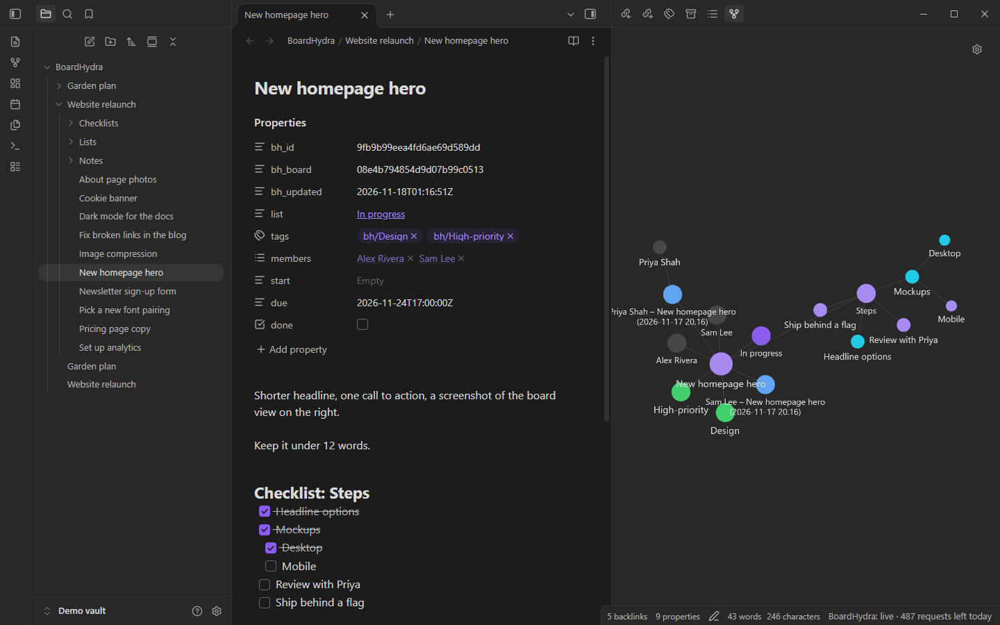
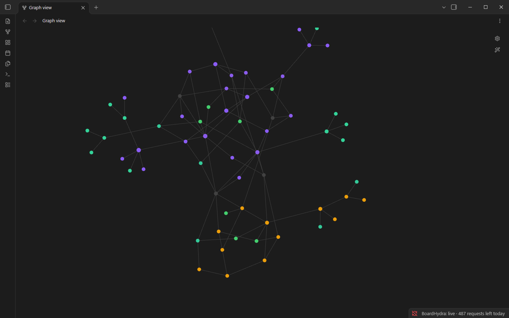
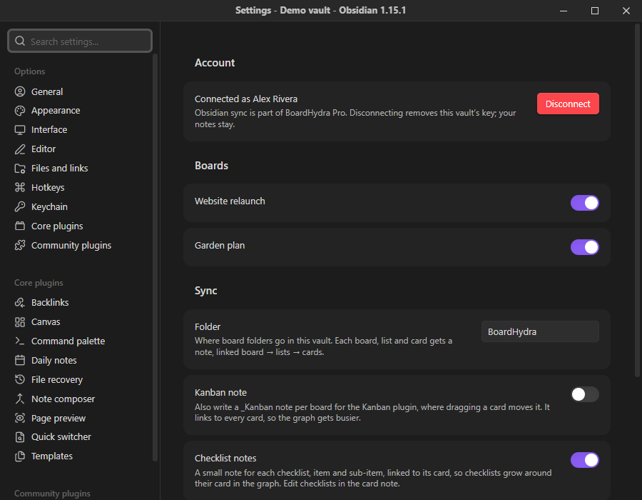

# BoardHydra for Obsidian

Sync your [BoardHydra](https://boardhydra.com) boards with your vault, both ways. Each board, list and card becomes
a note, linked board → lists → cards, so the graph view shows your boards as trees. Labels become `#bh/…` tags.
Needs BoardHydra **Pro** or **Business**.





## Connect
1. Install the plugin and turn it on.
2. Settings → BoardHydra → **Connect**. Your browser opens BoardHydra. Sign in and choose **Connect**.
3. Obsidian opens again and finishes. If it doesn't, copy the code from the page into **Paste code**.
4. Choose the boards to sync.



Disconnect any time in the plugin settings, or on the website under Account → Integrations.

## What you get
```
BoardHydra/
  My board.md            ← the board: links to its lists
  My board/
    Lists/
      To do.md           ← a list: links to its board and its cards
    Fix login.md         ← one note per card (links back to its list)
    Notes/
      Sam Lee – Fix login (2026-11-17 14.38).md   ← each note someone wrote on a card
    _Kanban.md           ← optional, for the Kanban plugin (Settings → Kanban note)
    _archive/            ← cards archived in BoardHydra
    _conflicts/          ← your version, when both sides changed a card at once
```

Board and list notes are rewritten by the plugin; edit cards, not them.

A card note:
```markdown
---
bh_id: 6f1c…            # don't edit
bh_board: 2a9e…
bh_updated: 2026-11-17T10:00:00Z
list: "[[BoardHydra/My board/Lists/To do|To do]]"
tags: [bh/Bug, idea]
members: ["[[Sam Lee]]"]
start: 
due: 2026-11-21T17:00:00Z
done: false
---
The description, in Markdown.

## Checklist: Steps
- [x] one
- [ ] two
  - [ ] a sub-item

## Links
- [Example](https://example.com)
```

- **Edit a note**: the card updates in BoardHydra about 2 seconds after you stop typing.
- **Rename the file**: the card is renamed.
- **Change `list:`** (the list's name or a link to its note), or drag a card in the Kanban note: the card moves.
- **Labels are tags** starting with `bh/` (spaces become `-`, so "High priority" is `#bh/High-priority`).
  Add or remove them to change the card's labels. Your own tags, and any properties you add, are kept.
- **Members are links**, so each person shows up in the graph next to their cards.
- **Notes on cards** (the Notes section at the bottom of a card in BoardHydra) each get their own note in `Notes/`,
  linked to the card and to the person who wrote it. Edit or delete your own there and it syncs; other people's
  notes are read-only. To write one, open a card note and run **Add a note to this card**.
- In the graph view, turn on **Tags** under Filters to see labels as nodes too.
- **Checklists in the graph**: each checklist, item and sub-item gets a small note in `Checklists/<card>/`, linked
  card → checklist → items → sub-items, so checklists sprout around their card in the graph. They're read-only (edit
  checklists in the card note) and have `done: true` once ticked, so a graph group like `[done:true]` can color
  finished items. Turn them off under **Checklist notes** in settings.
- **New note in a board folder**: a new card in the `list:` you give (or the first list).
- **Delete a note**: the card is archived in BoardHydra, never deleted. Restore it from the board's archive.
- **Changes in BoardHydra** show up live.
- **Both changed at once**: the note shows the BoardHydra version, and yours is saved in `_conflicts/`.

Lists, labels and members are made in BoardHydra. A name in the note that doesn't exist on the board is skipped, with a notice.

## Requests
Sync uses your plan's API requests: one per board when Obsidian starts, one per change you make. Live updates are free.
Pro includes 500 requests a day.

## Disclosures
- **Account required:** you need a BoardHydra account ([boardhydra.com](https://boardhydra.com)).
- **Payment required:** syncing needs a paid BoardHydra plan, **Pro** or **Business**. The plugin itself is free and open source (MIT).
- **Network use:** the plugin connects only to your BoardHydra server (`boardhydra.com` unless you change **Server** in
  the settings), to read and update your boards and receive live updates. It sends nothing anywhere else, and has no
  telemetry or ads.
- **Files:** it only reads and writes inside the BoardHydra folder of your vault (set in the settings), plus its own settings file.

## Privacy
Its key is stored in this vault's plugin settings (`.obsidian/plugins/boardhydra/data.json`). Treat that file like a
password, and leave it out of public vault backups.

## Develop
```
npm install
npm run dev      # rebuilds main.js on change
npm test         # note format tests
npm run build    # type-check + production bundle
```
Copy `main.js`, `manifest.json` and `styles.css` into `<vault>/.obsidian/plugins/boardhydra/` to try it.
Set **Server** in the settings to a local BoardHydra (`http://localhost:8080`) for testing.

## Release
1. Bump `version` in `manifest.json` and `package.json`, and add it to `versions.json`.
2. `npm run build`, then make a GitHub release whose tag is the version (no `v`), with `main.js`, `manifest.json` and `styles.css` attached.
3. First listing only: at [community.obsidian.md](https://community.obsidian.md), sign in, link the GitHub account that
   owns this repo, and add the plugin ("Set up and claim"). Review is automatic; fix anything it flags with a new release.
   Later releases need no submission, Obsidian picks them up from GitHub.
