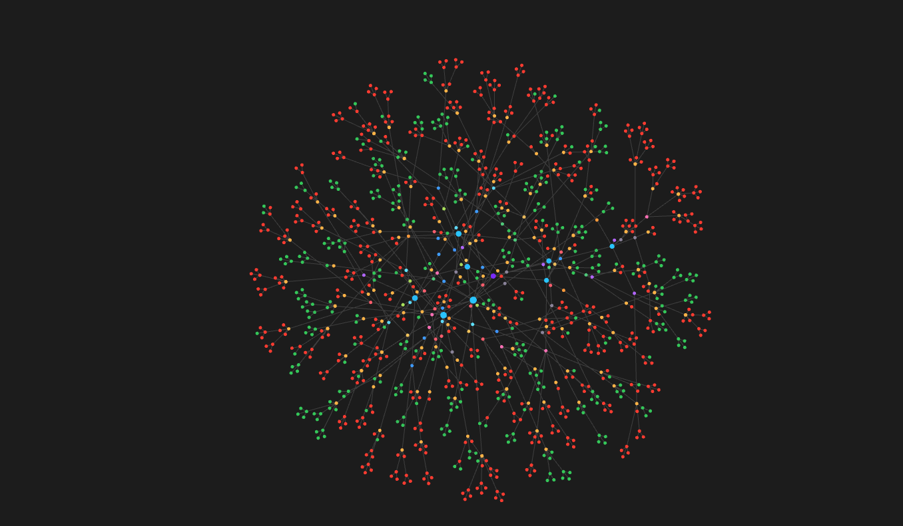

# Tidy up a board with AI

This page is a ready-made prompt that turns a messy board into a clean Obsidian graph. When it's done, the graph looks like this:



- Every card hangs off its list, and every list off its board. Nothing floats on its own.
- Every card has a short name. The details are in its description.
- Every card has at least one label, so every dot in the graph has a color.
- Big pieces of work are broken into checklists, with sub-items where it helps. Open items show red and finished ones turn green.

It takes about 15 minutes. Most of that is reading the AI's plan and saying yes.

## Before you start

1. Sync the board with the BoardHydra plugin.
2. In the plugin settings, turn on **Checklist notes** and **Color the graph by label**, and turn off **Kanban note**.
3. Pick an AI that can **open and edit the files in your vault**, such as Claude Code, Codex or Gemini CLI started in your vault folder, or an Obsidian AI plugin that's allowed to edit notes.
   A chat-only AI works too, but it can only write the plan. You'd make the changes yourself.

## How to use it

1. Copy everything in the box below.
2. Replace `My board` with your board's name, and tell the AI what the board is for in one line.
3. Paste it into your AI and follow along. It asks before changing anything.

```text
Help me restructure my BoardHydra board "My board" so it makes a clean, fully connected graph in Obsidian.
The board is for: <one line about what this board tracks>.

The board is synced by the BoardHydra plugin into the folder "BoardHydra/My board" in this vault.
Every card is a note in that folder. Read all of them before you suggest anything.

HOW THE NOTES WORK (follow this exactly, or the sync breaks)
- Renaming a card note's file renames the card.
- The "list:" property says which list the card is in. Use the same link format the note already uses,
  pointing at the list's note in the "Lists" folder.
- Labels are tags that start with "bh/" (spaces become "-": "High priority" is "bh/High-priority").
  A label must already exist on the board in BoardHydra. Tags without "bh/" are mine; leave them alone.
- The text under the properties is the card's description.
- Checklists live in the card note, as a heading plus checkbox lines. Indent a line by two spaces to make it a
  sub-item (one level deep only):
    ## Checklist: Name
    - [ ] Item
      - [ ] Sub-item
- A new note in the board folder, with a "list:" property, becomes a new card.
- Moving a card note into the "_archive" folder archives the card. Nothing is ever deleted.
- Never change bh_id, bh_board or bh_updated.
- Never edit these, because the plugin writes them: the board's own note, anything in "Lists", "Checklists" or "Notes",
  and "_archive/Archived cards".
- Lists and labels can't be created from Obsidian. When I need new ones, tell me and I'll make them in BoardHydra.

THE STRUCTURE I WANT
1. Lists show where the work is, from left to right:
   Ideas (an inbox for new, unsorted ideas), then a few backlog lists that sort the work by kind
   (for example Bugs, Polish, Features; choose kinds that fit this board), then Up Next, In Progress, Done.
   Keep my existing lists if they already fit, and suggest archiving lists that end up empty.
2. Labels show what a card is about. Give every card at least one label. Keep the labels I already have.
   Don't add a label that just repeats a list (like a "Done" label on a "Done" list) unless I already use one.
3. Card names are short: 2 to 6 words, no full sentences. If a name is really a description, move that text into
   the description and give the card a short name.
4. Descriptions are plain text: one to three short paragraphs, or a simple list with "- ". No bold, headings or
   other formatting, because BoardHydra shows descriptions as plain text.
   Say what the card is for and what "done" means.
5. Several small cards about the same thing become one card with a checklist, with one item per old card.
   Move the old cards to "_archive".
6. Big cards get checklists that break the work into steps, with sub-items where a step has parts.
   Item names are short, 2 to 5 words, because every item becomes a node in the graph.
7. Cards in Done get every checklist item ticked.
8. Don't make up facts about the project. If you don't know something, write it as an open question in the description.

HOW TO WORK
Step 1: Read every card note. Then show me your plan as a table:
        old name → new name, list, labels, and checklists (with their items).
        Underneath, list the new lists and labels I need to create in BoardHydra, and which cards you'd archive.
        Then stop and wait for my OK. Change the plan if I ask.
Step 2: Once I say the lists and labels exist, change the notes one card at a time. Rename the file, then update
        the properties, description and checklists. Leave a couple of seconds between notes so each change can sync.
Step 3: When you're done, tell me in a few lines what changed. If any note couldn't be changed, say which and why.
```

## Tips

- **Start small.** If your board is big, ask the AI to do one list first, and check the result in BoardHydra.
- **Changed your mind?** Archived cards can be restored from the board's archive in BoardHydra. A rename can be
  undone by renaming the note back.
- **A tag didn't stick?** The plugin shows a notice when a label doesn't exist on the board. Create the label in
  BoardHydra, then save the note again.
- **Reading the colors:** each card takes the color of its first label, in the order labels appear in BoardHydra.
  Drag labels in BoardHydra to choose which one wins.
